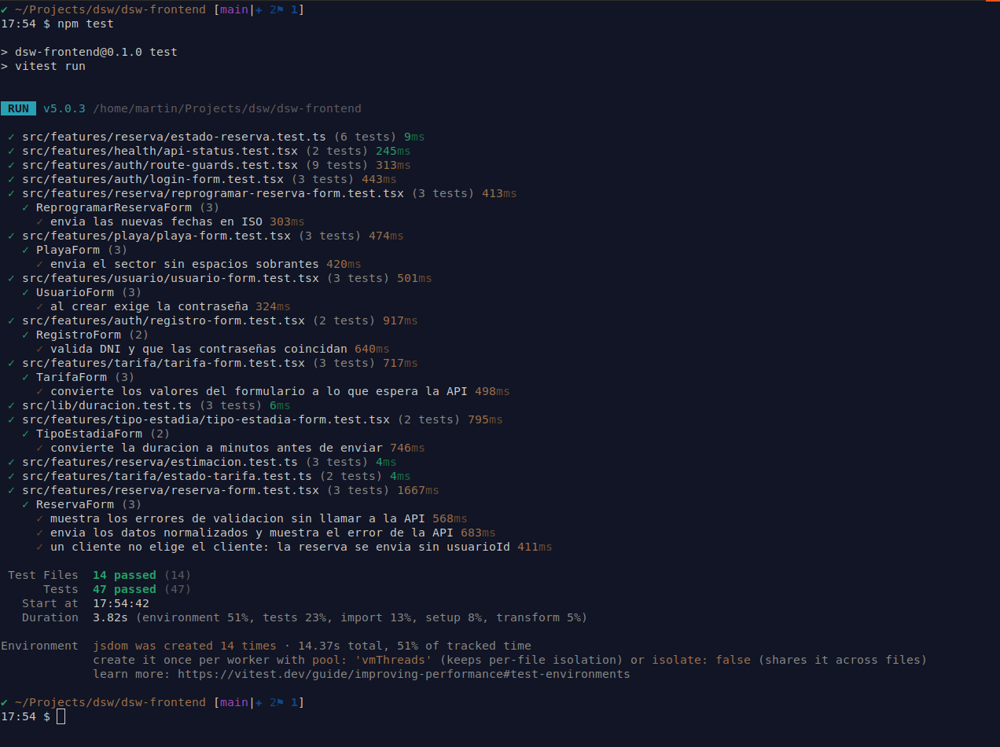

# DSW Frontend: gestión de reservas de estacionamiento

Aplicación web (SPA) del trabajo práctico de **Desarrollo de Software** (UTN). Interfaz para administrar playas, cocheras, tarifas, reservas y pagos, y para que los clientes gestionen sus reservas.

- Propuesta del TP: [tp-dsw/proposal.md](https://github.com/mapszk/tp-dsw/blob/main/proposal.md)
- API (backend): [mapszk/dsw-api](https://github.com/mapszk/dsw-api)
- Documentación del proyecto: [docs/README.md](docs/README.md)
- Video demo de la aplicación: [YouTube](https://youtu.be/bgZAVnIS35E)

## Índice

1. [Stack tecnológico](#stack-tecnológico)
2. [Aplicación desplegada](#aplicación-desplegada)
3. [Usuarios de prueba](#usuarios-de-prueba)
4. [Instalación y ejecución local](#instalación-y-ejecución-local)
5. [Variables de entorno](#variables-de-entorno)
6. [Tests](#tests)
7. [Comandos útiles](#comandos-útiles)
8. [Estructura del proyecto](#estructura-del-proyecto)
9. [Reglas del equipo](#reglas-del-equipo)

## Stack tecnológico

- React 19 + TypeScript
- Vite (SPA, todo del lado del cliente)
- React Router
- Tailwind CSS 4 + shadcn/ui
- TanStack Query
- React Hook Form + Zod
- Vitest + Testing Library
- ESLint + Prettier

## Aplicación desplegada

| Servicio                   | URL                                   |
| -------------------------- | ------------------------------------- |
| Frontend (Vercel)          | https://dsw-frontend-blush.vercel.app |
| API (Render)               | https://dsw-api.onrender.com/api      |
| Documentación (Swagger UI) | https://dsw-api.onrender.com/api/docs |

La API está en el plan gratuito de Render: después de un rato sin uso se suspende y el primer pedido puede tardar alrededor de un minuto en responder.

## Usuarios de prueba

El seed de la [API](https://github.com/mapszk/dsw-api) carga estos usuarios, disponibles tanto en la aplicación desplegada como en local:

| Rol           | Correo          | Contraseña |
| ------------- | --------------- | ---------- |
| Administrador | admin@dsw.com   | dsw12345   |
| Cliente       | cliente@dsw.com | dsw12345   |

Para probar los pagos online con MercadoPago, al pagar una reserva iniciar sesión en MercadoPago con esta cuenta de prueba (comprador) y/o usar las [tarjetas de prueba de MP](https://www.mercadopago.com.ar/developers/es/docs/checkout-pro/additional-content/your-integrations/test/cards):

| Cuenta MercadoPago | Usuario                    | Contraseña |
| ------------------ | -------------------------- | ---------- |
| Comprador          | TESTUSER354153819273760519 | 6Sxk6O1Q8o |

## Instalación y ejecución local

### Paso a paso

**1. Clonar el repositorio**

```bash
git clone https://github.com/mapszk/dsw-frontend.git
cd dsw-frontend
```

**2. Instalar dependencias**

```bash
npm install
```

**3. Crear el archivo de variables de entorno**

```bash
cp .env.example .env
```

**4. Levantar la aplicación**

```bash
npm run dev
```

## Variables de entorno

Se configuran en el archivo `.env` (copiado de `.env.example`).

| Variable           | Valor por defecto       | Descripción                                                                                                       |
| ------------------ | ----------------------- | ----------------------------------------------------------------------------------------------------------------- |
| `VITE_API_URL`     | `/api`                  | URL base de la API que usa el navegador. Se recomienda dejar `/api` para que las llamadas salgan al mismo origen. |
| `API_PROXY_TARGET` | `http://localhost:3000` | Solo en desarrollo: dirección de la API a la que el servidor de Vite reenvía las llamadas a `/api`.               |

En desarrollo, Vite reenvía `/api` a `API_PROXY_TARGET`, así que no hay problemas de CORS. En el deploy de Vercel, `VITE_API_URL` también es `/api` y `vercel.json` reenvía esas llamadas a la API en Render.

## Tests

**Tests unitarios y de componentes** (Vitest + Testing Library), no necesitan la API:

```bash
npm test
```

**Tests end-to-end** (Playwright): necesitan la [API](https://github.com/mapszk/dsw-api) levantada en `http://localhost:3000` con el seed cargado. Playwright levanta el frontend solo.

```bash
npx playwright install chromium   # solo la primera vez
npm run test:e2e
```

Cada test se ejecuta en escritorio y en celular. El reporte queda en `playwright-report/` y se abre con `npx playwright show-report`.

Resultado de la ejecución de los tests unitarios:


